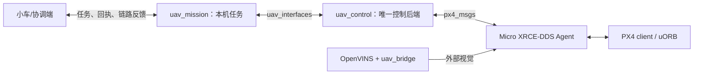

# 无人机 DDS 开发流程

更新日期：2026-10-15。本文只维护验证阶段；包接口见 [uav_control](https://github.com/QU-of-boomboom/uav_control/blob/main/README.md)，
当前源码与历史软件证据见 [验证边界](当前src静态审查.md)。本次只整理文档，未执行以下步骤。

## 两条链路



飞控控制链在本机维持；跨机业务网络只引入任务和状态，不直接增加第二个飞控指令发布者。
DDS 依赖已有 IP 网络；移动 AP 是物理网络层。MAVROS 可用于独立回归，同次试验只选一个自动控制后端。

## A0：核对运行基线

记录主机架构、ROS/RMW、PX4 固件标签和 SHA、px4_msgs/Agent 版本、Gazebo/机型、Domain、命名空间、
传输接口、实际参数、各仓库 HEAD 与未提交改动、构建和安装路径。软件基线为本地 px4_msgs v1.17.0，
不代表板端已部署同版 PX4；消息和话题集合须与实际固件的 `dds_topics.yaml` 匹配。

当前实现要求 `UXRCE_DDS_SYNCT=1`、Agent 与 ROS 主机系统时间一致，不支持 `/clock` 或 `use_sim_time`，
不再次叠加 Timesync offset。采样年龄、接收间隔和 QoS 必须实测，Agent 会话建立不能代替数据交付。

## A1：只读通信

准备匹配的 PX4/SITL 和 Agent 后，在工作区根目录加载实际 overlay，确认集中配置仍为只读：

```bash
source /opt/ros/humble/setup.bash
source install/local_setup.bash
ros2 launch uav_bringup uav.launch.py config_file:="$PWD/src/uav_bringup/config/uav.yaml"
ros2 topic echo /uav_control/state --once
```

默认不启动任务、相机、OpenVINS 或桥接，也不启动 PX4、Agent 或 Gazebo。
消息后缀由本地消息 `MESSAGE_VERSION` 决定，DDS 前缀来自 `uav_control.dds.fmu_prefix`，不得把 `_v1` 写死。

| 方向 | 消息及用途 |
| --- | --- |
| PX4 → ROS | VehicleStatus、VehicleLocalPosition、VehicleAttitude、VehicleLandDetected：状态、导航、姿态和落地 |
| PX4 → ROS | TimesyncStatus、VehicleCommandAck：同步与命令关联 |
| 定位输入 | SensorCombined → `/px4/imu`；独立启动定位时才运行 imu_bridge |
| ROS → PX4，控制启用后 | OffboardControlMode、TrajectorySetpoint、VehicleCommand |
| ROS → PX4，桥接单独启用后 | VehicleOdometry：外部视觉输入 |

只读 DDS 控制不创建控制输出、目标订阅或飞行命令服务；仍发布统一状态并提供地面 reset。
需记录实际消息值、频率、最大间隔、采样年龄与断连/重启恢复。话题可列出或节点图存在不等于数据可用。

## A2/A3：控制与 SITL

完成 A1 后，用集中配置副本显式将所选后端 `read_only` 设为 false；自动任务单独设置 `start_mission:=true`。
VIO 输出仍由独立的 `uav_bridge.enabled` 控制。构建见 [手动构建](OpenVINS手动编译与验证.md)，
仿真入口见 [sim README](../sim/README.md)。这些开关不能互相代替。

正常任务为等待就绪 → 当前位置准备 → 实际 Offboard/解锁确认 → 相对升高 1 m → 稳定 2 s → 悬停 10 s
→ LAND → 新鲜落地与未解锁确认。软件配置的水平/高度容差为 0.2/0.15 m，不自动作为实飞判据。

| 故障用例 | 必须区分的结果 |
| --- | --- |
| 取消及 pending ARM | 取消接受与飞控真正落地/未解锁分开；不能认为移除本地请求就撤回命令 |
| 任务进程停止 | 控制仍工作时的目标超时与主动 LAND |
| 控制进程停止 | PX4 的 Offboard-loss 行为；参数及实际动作单独记录 |
| Agent/传输中断 | 旧状态失效，恢复后不重新执行旧任务 |
| 定位、航向/速度失效或原点重置 | 中止旧参考目标；状态恢复、地面 reset 和新任务分别确认 |
| ACK 拒绝、丢失、迟到或 IN_PROGRESS | 保留命令关联；最终 ACK 与真实模式/解锁状态分开 |
| LAND 交接和人工接管 | AUTO.LAND 后停止目标；人工接管后不抢回控制或自动 LAND |

一次只保留一个待处理命令。DDS ACK 无应用请求 ID，超时 opcode 在进程内隔离，reset 不清除；
ARM/DISARM 共用 opcode，需在地面更换 source_component 并重启后再建立新任务。
定位无效或断链时停止心跳，后续实际动作由现场 PX4 配置决定。

## A4/A5：台架、定位与实飞

板端先核对型号、供电、UART 电平/波特率或 UDP、固件、驱动、时钟和资源。拆桨、未解锁，先复验只读数据，
再按 [Position 验证](Position启动与验证.md) 检查方向、尺度、外参、视觉供数、PX4 接收和 EKF2 融合。
当前 DDS IMU 和 VehicleOdometry 适配已有源码，尚无当前修订的板端接收/融合结论。

台架与 SITL 通过后再制定实飞场地、范围、误差、接管和异常处置判据；不直接套用仿真高度或参考仓库门限。
按短程起飞、保持、降落逐步验收，保留 ROS 证据与 PX4 ULog。

## B：跨机器人业务

| 阶段 | 工作和通过条件 |
| --- | --- |
| B0 业务契约 | 定义任务来源、编号/会话、有效期、取消与断链行为；明确本地 map 与共同坐标的转换 |
| B1 固定 AP | 先 PC↔Orange Pi，再加入小车；核对发现、双向交付、频率、最大间隔和序号缺口；时钟可信时才报告单向延迟 |
| B2 断链与恢复 | 先替代执行器/SITL，再台架；本机飞控链独立运行，迟到或重复任务不重放，恢复需新任务 |
| B3 移动补位 | 先固定 AP 基线，再引入有限候选位置；分别记录飞行、业务通信和移动 AP 的收益 |

按接口选择 QoS，适配 PX4 best-effort 状态；任务/回执需要应用确认和过期规则。
Domain 用于发现隔离、命名空间用于区分接口，均不替代网络连通性验证。首轮沿用原生 DDS；
只有实测发现或带宽问题后才评估分域/桥接，避免同一业务重复传输。

每次记录日期、版本/工作树、参数、输入操作、冻结判据、原始证据和通过/失败/未执行。
静态、构建、ROS 通信、SITL、台架、融合、实飞和跨机业务分别下结论。
